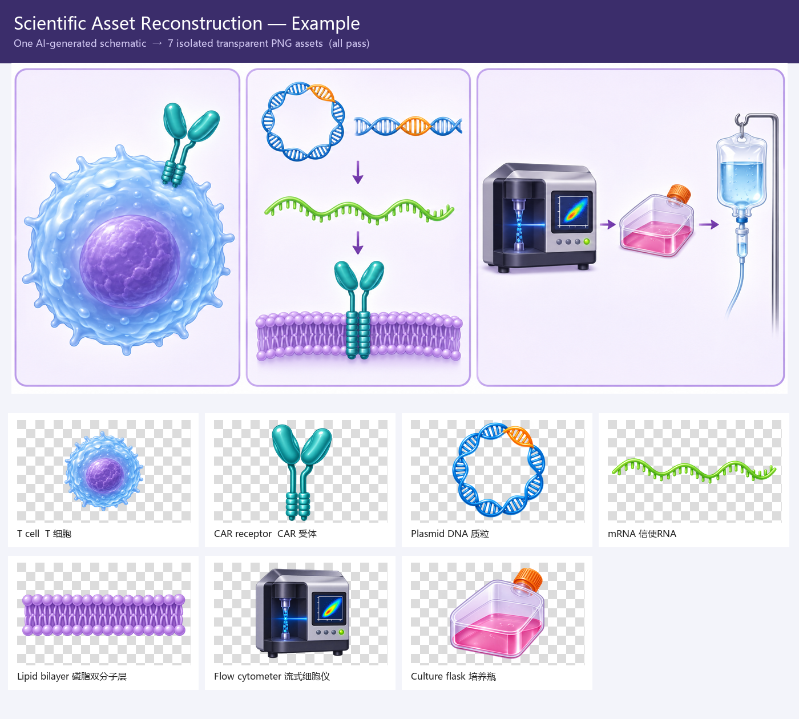

# 示例 / Example

用一张 **AI 生成的原创示意图** 演示 "参考图 → 拆解 → 独立透明素材" 的完整流程。
示意图由 AI 生成，**不含任何第三方版权素材**，可安全用于演示与再分发。

An end-to-end demo of "reference figure → decomposition → isolated transparent assets" using an
**AI-generated original schematic** (no third-party copyrighted material).



## 这张图 / This figure

- 来源 / Source：AI 图像模型生成（`reference_figure.png`），原创的 CAR-T 治疗流程示意图。
- 内容 / Content：T 细胞与 CAR 受体、质粒与 mRNA、磷脂双分子层与膜上 CAR、流式细胞仪 / 培养瓶 / 输液袋。
- 无文字、无第三方素材；仅用于演示方法与透明素材效果。

## 产出 / Outputs

`assets/` 下为按最小粒度拆出的独立透明 PNG（真 alpha，全部通过机器质检）：

| # | 文件 | 元素 | 有效尺寸 |
|---|---|---|---|
| 1 | `assets/01_t_cell.png` | T 细胞 | 1062×1077 |
| 2 | `assets/02_car_receptor.png` | CAR 受体 | 809×1301 |
| 3 | `assets/03_plasmid_ring.png` | 质粒 DNA 环 | 1117×1134 |
| 4 | `assets/04_mrna_strand.png` | mRNA 链 | 2005×310 |
| 5 | `assets/05_membrane_bilayer.png` | 磷脂双分子层 | 1631×421 |
| 6 | `assets/06_flow_cytometer.png` | 流式细胞仪 | 1052×1005 |
| 7 | `assets/07_culture_flask.png` | 细胞培养瓶 | 1108×1065 |

`qc/` 为机器质检输出：`audit.csv`、`audit.json`、三背景预览、`manifest.csv`、`quality_report.md`。
7/7 素材机器判定 `pass`（不代表视觉/科学认证，正式使用仍需人工目视复核）。

## 复现 / Reproduce

```bash
S=scientific-asset-reconstruction/scripts
python $S/crop_reference.py reference_figure.png --box x0,y0,x1,y1 --out crops/el.png   # 按坐标裁局部参考
# 用你的图像工具按 "只重绘该图元 + 主体充满画面约 85% + 透明背景" 生成，得到 raw/*.png
python $S/trim_assets.py raw --out assets --target 1024                                # 裁留白 + 报告有效尺寸
python $S/audit_assets.py assets --out qc --target 1024                                # 只读质检 + 预览/清单
```
